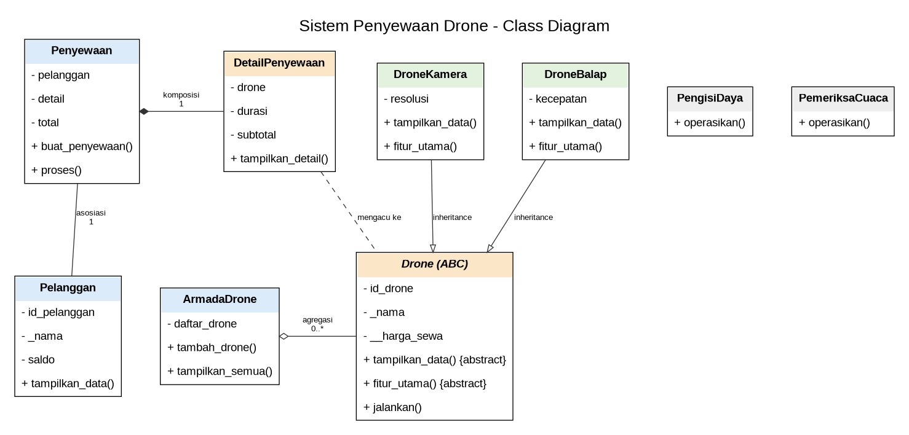

# Sistem Penyewaan Drone

Program Python untuk simulasi penyewaan drone. Pengguna dapat login, melihat data pelanggan dan drone, membuat penyewaan, memproses pembayaran menggunakan saldo, serta melakukan top up.

## Class Diagram



### Penjelasan relasi

- **Asosiasi — `Penyewaan` dengan `Pelanggan`:** `Penyewaan` menyimpan objek pelanggan pada atribut `self.pelanggan`. Relasi ini merupakan asosiasi karena penyewaan berhubungan dengan pelanggan yang sudah ada, dan objek pelanggan dapat tetap hidup/ digunakan tanpa objek penyewaan.
- **Agregasi — `ArmadaDrone` dengan `Drone`:** `ArmadaDrone` menyimpan objek drone dalam `daftar_drone` melalui `tambah_drone()`. Ini agregasi karena drone dibuat secara terpisah (`drone1` dan `drone2`) dan tetap dapat berdiri sendiri walaupun armada dihapus.
- **Komposisi — `Penyewaan` dengan `DetailPenyewaan`:** `Penyewaan.buat_penyewaan()` membuat objek `DetailPenyewaan` dan menyimpannya pada `self.detail`. Detail tersebut merupakan bagian dari data penyewaan dan dibuat/dikelola oleh penyewaan, sehingga ditunjukkan sebagai komposisi.

## Abstraksi

Class `Drone` merupakan abstract base class yang mewarisi `ABC`. Class ini memiliki abstract method `tampilkan_data()` dan `fitur_utama()` yang harus diimplementasikan oleh `DroneKamera` dan `DroneBalap`. Method konkret `jalankan()` tersedia dan digunakan bersama oleh kedua subclass. Program mencoba membuat objek `Drone` secara langsung dan menangkap `TypeError` sebagai bukti bahwa abstract class tidak dapat diinstansiasi.

## Polimorfisme

- **Polimorfisme melalui inheritance:** `DroneKamera` dan `DroneBalap` meng-override `tampilkan_data()` dan `fitur_utama()` dengan perilaku yang berbeda. Keduanya dipanggil melalui satu loop pada `menu_demo_oop()`.
- **Duck typing:** `PengisiDaya` dan `PemeriksaCuaca` tidak memiliki relasi inheritance satu sama lain, tetapi keduanya menyediakan `operasikan()`. Fungsi `jalankan_perangkat(perangkat)` memanggil method yang sama tanpa memeriksa tipe objek.
- **Operator overloading:** class `Drone` mengimplementasikan `__str__()`, sehingga objek drone dapat ditampilkan dengan `print(drone)`.

## Cara menjalankan

1. Pastikan Python 3 sudah terpasang.
2. Jalankan `python Posttest2_updated.py`.
3. Login menggunakan salah satu akun contoh:
   - Username: `geo`, Password: `121`
   - Username: `budi`, Password: `123`
4. Pilih menu `7. Demo Abstraksi & Polimorfisme` untuk menampilkan demonstrasi konsep OOP.

## Contoh output demo

```text
===== DEMO ABSTRAKSI & POLIMORFISME =====

Bukti abstract class tidak dapat diinstansiasi:
TypeError: Can't instantiate abstract class Drone ...

Polimorfisme via pewarisan:
Drone DJI Mini 4 Pro siap digunakan.
Fitur kamera: merekam video dengan resolusi 4K.
DJI Mini 4 Pro (ID: D001, Rp150,000/hari)
Drone DJI Avata 2 siap digunakan.
Fitur balap: kecepatan maksimum 97 km/jam.
DJI Avata 2 (ID: D002, Rp200,000/hari)

Duck typing:
Pengisi daya: mengisi baterai drone.
Pemeriksa cuaca: memeriksa kondisi cuaca sebelum terbang.
```

> **Screenshot output:** Jalankan program, masuk ke menu `7`, lalu ambil screenshot terminal yang menampilkan bukti abstract class tidak dapat diinstansiasi, polimorfisme, dan duck typing. Tambahkan screenshot tersebut ke README ini (misalnya simpan sebagai `output_demo.png` dan sisipkan ``). Contoh output di atas adalah teks ilustratif, bukan screenshot aktual.

## Prinsip SOLID (nilai plus)

Penerapan yang mendekati **Open/Closed Principle (OCP)**: perilaku drone dipisahkan ke subclass melalui method `fitur_utama()` dan `tampilkan_data()`. Jenis drone baru dapat ditambahkan sebagai subclass `Drone` dengan mengimplementasikan abstract method tanpa mengubah implementasi subclass drone yang sudah ada. Untuk mendukung jenis drone baru pada pilihan penyewaan, bagian pilihan menu juga perlu diperluas.
